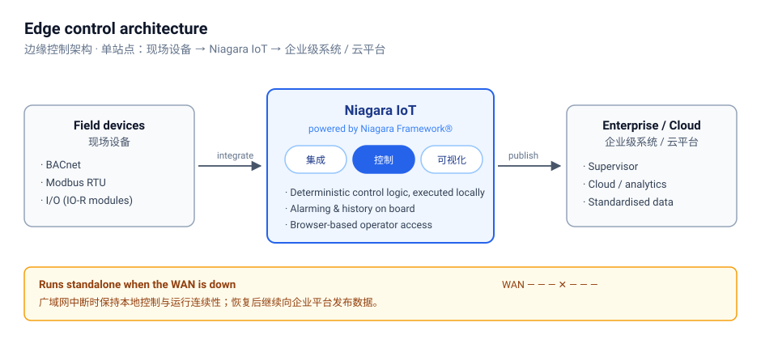
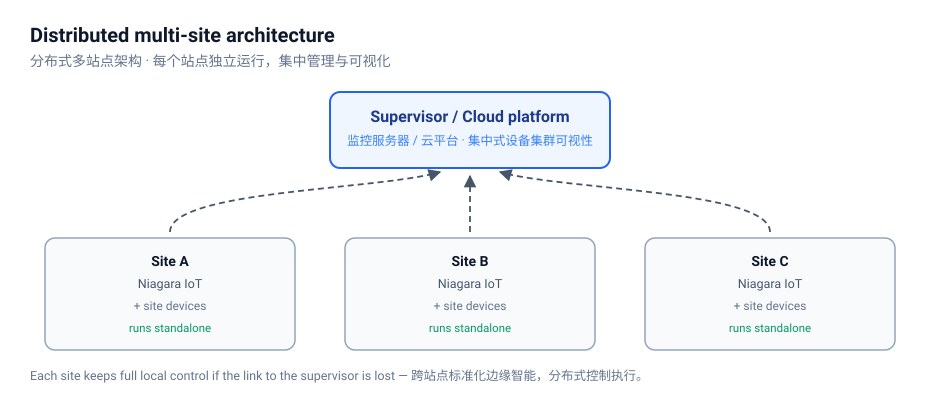
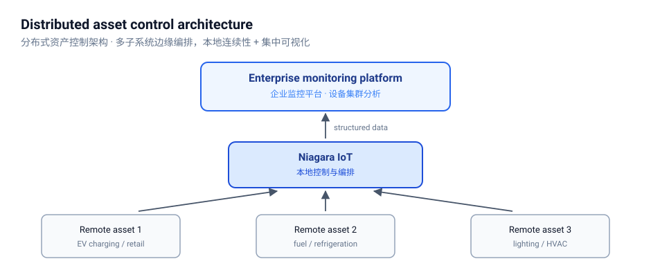

# Niagara IoT — Architecture, Sizing and Lifecycle Guide

> **Last verified: 18 November 2026.** Architecture and specifications are summarised from Tridium's published Niagara IoT datasheet (March 2026). Lifecycle dates are quoted from Tridium-published FAQ material. The diagrams below are our own illustration of the architecture patterns described in that documentation — no Tridium artwork is reproduced.
>
> 本文最后核对：2026-11-18。架构与规格摘要自 Tridium 公布的 Niagara IoT 数据手册（2026 年 3 月），生命周期日期引自 Tridium 公布的 FAQ。文中架构图为**我方自绘**，未转载 Tridium 任何原文图稿。

---

## What Niagara IoT is

Niagara IoT is a **compact, embedded, full-stack edge controller**. It runs deterministic control logic, integrates heterogeneous field devices, manages alarms and history, and serves local visualization — all inside the Niagara Framework, in a single runtime.

The point of that combination is **autonomy**. A Niagara IoT site keeps controlling, alarming and logging while the wide-area link to the enterprise or cloud is down. When the link returns, standardized data flows upward again.

It is sized for **low-to-medium density deployments** that need embedded sequence control, device orchestration, and secure device-to-cloud communication — not for large central plant.

---

## Architecture

Niagara IoT is documented against three deployment patterns. The diagrams below are drawn to make each one obvious at a glance.

### 1. Edge control — single site

Field devices on the left, enterprise or cloud on the right, and the controller doing **integrate → control → visualize** in the middle. Control logic executes locally; data is published upward. Losing the WAN does not stop the site.

### 2. Distributed multi-site

Multiple Niagara IoT controllers, one per site, each running standalone, presented as a single estate through a Supervisor or cloud platform. Standardized edge intelligence across sites, with distributed control execution — a failure of one site never cascades.

### 3. Distributed asset control

One controller orchestrating several subsystems at the edge, exposing structured data upward to an enterprise monitoring platform for fleet-level analytics. Local continuity is kept; visualization is centralized.

---

## Hardware and connectivity

| | |
|---|---|
| **CPU** | TI AM3352, 1000 MHz, ARM Cortex-A8 |
| **Memory** | 1 GB DDR3 SDRAM |
| **Storage** | Micro SD — 4 GB flash, 2 GB user storage |
| **Ethernet** | 2 × 10/100 Mb |
| **Serial** | 2 × isolated RS-485 |
| **Wi-Fi** | 802.11 a/b/g/n — client or WAP, configurable (off / WAP / client), WPA-PSK / WPA2-PSK |
| **USB** | Type A — backup and restore |
| **Power** | 24 V AC/DC |
| **Framework** | Niagara Framework 4.1 or later |
| **Analytics** | Niagara Analytics 2.1 compatible with Niagara 4.4 or later |
| **Security** | Secure boot; role-based authentication |
| **Clock** | Real-time clock, no battery |
| **Mounting** | DIN 43880 housing compatible; panel or EN 50022 35 mm rail |
| **Expansion** | Up to **four** expansion modules |
| **Operating temp.** | −20 to 60 °C |
| **Storage temp.** | −40 to 85 °C |
| **Humidity** | 5–95 %, non-condensing |
| **MTTF** | 10+ years |

**Approvals:** UL 916, CE EN 61326-1, RCM, FCC Part 15 Subpart B Class B, FCC Part 15 Subpart C, CSA C22.2 No. 205, 1999/5/EC R&TTE, CCC, SRRC, RSS, RoHS.

> Enterprise-grade security requires four hours of backup power — confirm the current requirement in the documentation for your Niagara release.

---

## Sizing: how point tiers work

Niagara IoT is licensed **against a total point count**, in three tiers:

| Tier | Point limit |
|---|---|
| **Niagara IoT-100P** | 100 points |
| **Niagara IoT-150P** | 150 points |
| **Niagara IoT-200P** | 200 points |

Practical implications:

- **Budget by points, not by devices.** The tier is defined by total points, so the number of integrated devices is not the constraint — the point total is.
- **Count points on the Niagara licence basis**, not the physical I/O count. Every monitored value and every writable command typically consumes points, and trend/history logging adds further capacity pressure. Leave 15–20 % headroom so a later sensor or setpoint does not force a tier change.
- **Above 200 points, quote a standard JACE.** Once the point count exceeds the top small-site tier, the economics move to a JACE-8000 / 9000 conversation.

---

## Ordering reference

| Part number | Description |
|---|---|
| **Niagara-IOT-100P** | Niagara IoT controller, 2 × 10/100 Mb Ethernet, 2 × RS-485, 100-point licence |
| **Niagara-IOT-150P** | Niagara IoT controller, 2 × 10/100 Mb Ethernet, 2 × RS-485, 150-point licence |
| **Niagara-IOT-200P** | Niagara IoT controller, 2 × 10/100 Mb Ethernet, 2 × RS-485, 200-point licence |
| **NPB-8000-2X-485** | Additional dual RS-485 serial expansion module |
| **NPB-8000-232** | Additional RS-232 serial expansion module |
| **IO-R-16** | Remote 16-point RS-485 I/O module (8 UI, 4 RO, 4 AO) |
| **IO-R-34** | Remote 34-point RS-485 I/O module (16 UI, 10 RO, 8 AO) |

---

## Where it fits

**Target industries:** EV charging networks · fuel and CNG stations · quick-service restaurant and distributed retail · remote utility and infrastructure sites · small commercial facilities.

**Core use cases:** embedded control inside packaged mechanical or electrical systems · distributed site automation (fuel, refrigeration, lighting, HVAC) · latency-sensitive control loops · operation independent of the wide-area network · local operator dashboards and maintenance access.

---

## Lifecycle context — the five dates that matter

| Date | What happens | Who is affected |
|---|---|---|
| **31 Dec 2025** | JACE-8000 **last order date passed** in Europe | European projects — already closed |
| **31 Dec 2026** | JACE-8000 **last order date** — North America, Middle East, Africa, **Asia Pacific** | JACE-8000 projects |
| **Q4 2026** | Niagara 5 **General Availability** | Everyone planning new work |
| **Q3 2028** | **Niagara 4 End of Life.** 4.15 is the LTS release and stops receiving updates | Every N4 station in service |
| **After 2028** | SMA can **still be purchased** for N4 JACEs and Supervisors | Maintenance-only sites |

Niagara IoT runs on the **Niagara 4** framework. Plan it against the **N4 End of Life date of Q3 2028** — N5 migration is a JACE-9000 and Supervisor conversation.

For a site that will be re-engineered before 2028, that is not a constraint. For a site expected to carry one controller into the 2030s, it is — size accordingly.

---

## JACE-8000 vs JACE-9000 (for migration context)

Both are current, both run Niagara 4, both are supported to 2028. The difference is what happens **after** 2028.

| | **JACE-8000** | **JACE-9000** |
|---|---|---|
| **Niagara 5 upgrade path** | ❌ No | ✅ Yes (N4 → N5) |
| Processor | — | Quad-core |
| RAM / Flash | — | 2 GB / 8 GB |
| Backup storage | Backup port | **8 GB uSD**, no backup port; automatic full backup daily at 02:00 |
| History capacity | Baseline | **10,000 histories** ≈ 1.6× the JACE-8000 |
| Option modules | Up to four IO-R modules | Current generation |
| Licensing model | NC-800x | NC-900x (e.g. **NC-9005 ≡ NC-8005**) |
| Last order | **APAC: 2026-12-31** | Through N4 End of Life (2028) |

> **Tridium's own answer:** *"Will the JACE 8000 be upgraded to Niagara 5? **No.** The JACE-8000 was able to transition from AX to N4; the JACE-9000 can transition from N4 to N5. We are working on a license change option so that a JACE-8000 license can be transferred to a JACE-9000."*

---

## Spare-parts and stock planning

### If you run JACE-8000 sites

After 2026-12-31 new JACE-8000 units stop shipping, but the installed base does not shrink. Every unit in the field keeps running, keeps aging, and eventually needs replacement with an identical unit — because re-engineering a working station to a different model costs far more than the hardware.

Three options, in order of cost:

1. **Hold a cold spare.** One identical unit per critical site, powered down, on the shelf.
2. **Pre-buy for known expansion.** Buy additional units and IO-R modules before the order window closes.
3. **Plan the 9000 migration.** Correct for long-horizon sites, but it is a re-engineering project, not a swap.

### If you are specifying new small sites

Niagara IoT is the fit when the site needs local control, alarms, history and a local dashboard without a full JACE, and when the point count lands inside 100 / 150 / 200. It runs standalone through WAN outages, which is usually the deciding argument for remote and distributed sites.

---

## FAQ

**What is Niagara IoT?**
A compact embedded edge controller that runs deterministic control, device integration, alarms, history and local visualization on the Niagara Framework in a single runtime.

**How many points does it cover?**
Three licence tiers: 100, 150 and 200 points. Above 200 points, quote a standard JACE.

**Is the limit based on devices or points?**
Points. The tier is defined by total point count, so the number of integrated devices is not the constraint.

**What field protocols does it support?**
Two isolated RS-485 ports plus two Ethernet ports, with expansion modules available (dual RS-485, RS-232). Protocol support follows the Niagara Framework drivers licensed on the station — confirm the specific driver set for your project.

**Does it keep working if the internet goes down?**
Yes. That is a core design characteristic: local control, alarming and logging continue, and data publishes upward when the link returns.

**Can it be expanded?**
Up to four expansion modules — additional serial ports, or IO-R-16 / IO-R-34 remote I/O.

**Does it have a Niagara 5 path?**
Plan it against the N4 lifecycle. N5 migration is a JACE-9000 and Supervisor conversation. Confirm current lifecycle guidance with Tridium.

**Can I still order a JACE-8000?**
In Asia Pacific, yes — until **31 December 2026**. Europe's window closed 31 December 2025.

**Can I buy an SMA after 2028?**
Yes. Tridium has confirmed SMA purchase remains available for N4 JACEs and Supervisors after the N4 EOL date.

---

## What this guide is not

- It is not a quotation. Prices are not published here.
- It is not a substitute for Tridium's official documentation — where this guide and Tridium's published material disagree, Tridium governs.
- The diagrams are our own illustration of documented architecture patterns, not Tridium artwork.
- It does not cover Niagara AX, which reached its own end of life earlier.

---

## Contact

**Shanghai Gline Net Co., Ltd. (GLINENET)** — Tridium partner since 2014.

- **Niagara IoT** supply, point-count sizing and stock planning — we help you put Niagara IoT on the right project at the right point tier, with availability confirmed before you commit
- JACE-8000 / JACE-9000 supply and spare-parts planning
- Niagara 4 station engineering, migration assessment, remote operations
- Email: **jason.zhang@gline-net.com**

*If you are planning 8000-class replacement or expansion in Asia Pacific, ask before the **2026-12-31** order deadline. For Niagara IoT selection and stock planning, **we hold availability into 2027** — get in touch and we will size it to your project. Sales policy and product terms are set by Tridium — confirm before any purchase decision.*

---

## Sources

1. **Tridium — Niagara IoT datasheet** (2026-B001, March 2026): product definition, architecture patterns, licence tiers, ordering information, hardware specifications, approvals and environmental ratings. Summarised above; no Tridium artwork reproduced.
2. **Tridium — Niagara 5 FAQ** (published 6 February 2025): regional last-order dates, N4 End of Life in Q3 2028, 4.15 as the LTS release, the JACE-8000 → N5 answer, SMA availability after EOL, N5 release phasing.
3. **Tridium — JACE-9000 FAQ** (2023): specification, uSD backup behaviour, history capacity, NC-900x ↔ NC-800x model mapping.
4. **Tridium — JACE-8000 product documentation**: option module capacity, environmental equivalence with the 9000.
5. **Tridium — IO R documentation**: IO R 16 / IO R 34 modules, up to four IO-R-16 per host.
