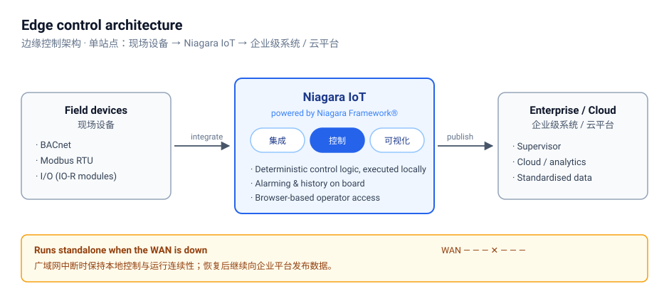
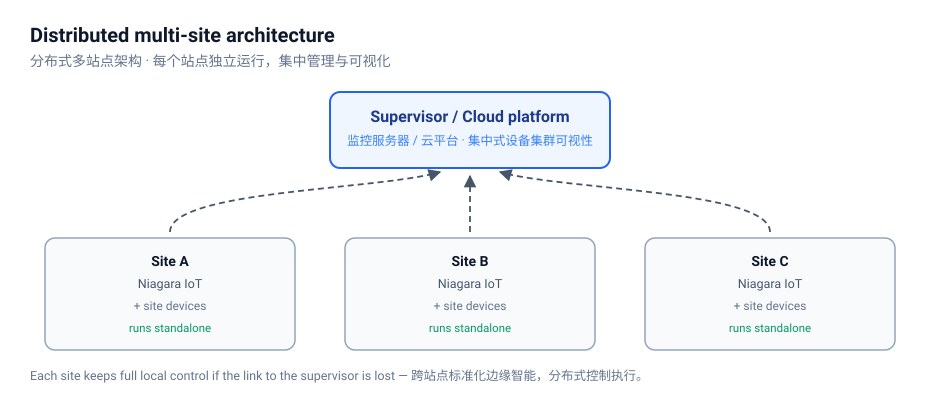
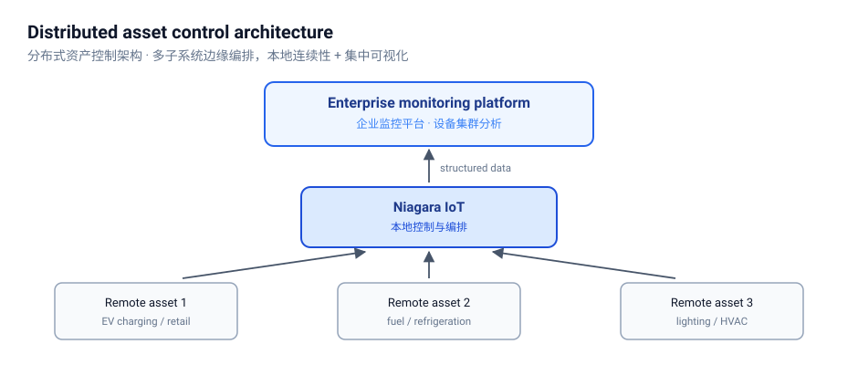

# Niagara IoT —— 架构、选型与生命周期指南

> 最后核对 2026-11-18，图自绘。

---

## 文档导航

| 文档 | 中文 | English |
|---|---|---|
| **Niagara IoT** —— 架构、硬件、点数选型、订货信息 | **当前页** | [English](README.md) |
| **JACE-8000 与 Niagara 4** —— 生命周期、停产时间线、迁移 | [中文版](docs/jace-8000-lifecycle.zh-CN.md) | [English](docs/jace-8000-lifecycle.md) |
| **Niagara IoT 数据表** —— 官方规格书（PDF） | [PDF](https://www.glinenet.com.cn/pdf/Niagara_IoT_Datasheets-CN_26.6.1.pdf) | [PDF](https://www.glinenet.com.cn/pdf/Niagara_IoT_Datasheet_EN_translated.pdf) |

两篇同步维护。Niagara IoT 这篇讲小站点控制器；JACE-8000 那篇讲 8000 / 9000 这一档的生命周期与迁移。

产品页：**[glinenet.com.cn/NiagaraProduct.html](https://www.glinenet.com.cn/NiagaraProduct.html)**

---

## Niagara IoT 是什么

Niagara IoT 是一款**紧凑型嵌入式全栈边缘控制器**。它在单一运行时内完成：确定性控制逻辑执行、异构现场设备集成、报警与历史数据管理、以及本地可视化 —— 全部跑在 Niagara Framework 之内。

这个组合真正的价值是**自主运行**：当连接企业级系统或云平台的广域网中断时，站点继续控制、继续报警、继续记录；链路恢复后，标准化数据重新向上汇聚。

它面向的是**中低密度部署**——需要嵌入式顺序控制、设备编排、安全的设备到云通信的场景，不是大型中央机房。

---

## 架构

Tridium 的文档给出三种部署模式。下面三张图是我方按这些模式自绘的，目的是让人一眼看懂。

### 一、边缘控制（单站点）

左边是现场设备，右边是企业级系统或云平台，中间这台控制器做 **集成 → 控制 → 可视化**。控制逻辑本地执行，数据向上发布。广域网断了，站点不停。

### 二、分布式多站点

每个站点一台 Niagara IoT，各自独立运行，通过 Supervisor 或云平台呈现为统一站点群。跨站点标准化边缘智能，控制分布式执行——**任一站点故障不会级联**。

### 三、分布式资产控制

一台控制器在边缘编排多个子系统，向上为设备集群分析暴露结构化数据。本地连续性保留，可视化集中。

---

## 硬件与接口

| 项目 | 规格 |
|---|---|
| **处理器** | TI AM3352，1000 MHz，ARM Cortex-A8 |
| **内存** | 1 GB DDR3 SDRAM |
| **存储** | Micro SD —— 4 GB 闪存 / 2 GB 用户存储 |
| **以太网** | 2 × 10/100 Mb |
| **串口** | 2 × 隔离 RS-485 |
| **Wi-Fi** | 802.11 a/b/g/n —— 客户端或 WAP，可配置（关闭 / WAP / 客户端），支持 WPA-PSK / WPA2-PSK |
| **USB** | A 型 —— 备份与恢复 |
| **供电** | 24 V AC/DC |
| **框架** | Niagara Framework 4.1 或更新版本 |
| **分析** | Niagara Analytics 2.1，兼容 Niagara 4.4 或更新版本 |
| **安全** | 安全启动；基于角色的身份认证 |
| **时钟** | 实时时钟，无电池 |
| **安装** | 兼容 DIN 43880 外壳；可装面板或 EN 50022 标准 35 mm 导轨 |
| **扩展** | 最多 **4 个**扩展模块 |
| **运行温度** | −20 至 60 °C |
| **储存温度** | −40 至 85 °C |
| **湿度** | 5–95 %，不冷凝 |
| **MTTF** | 10 年以上 |

**认证：** UL 916、CE EN 61326-1、RCM、FCC 第 15 部分 B 子部分 B 类、FCC 第 15 部分 C 子部分、CSA C22.2 No. 205、1999/5/EC R&TTE、CCC、SRRC、RSS、RoHS。

> 企业级安全需要四小时备用电源 —— 具体以你所用 Niagara 版本文档为准。

---

## 选型：点数档位怎么算

Niagara IoT 按**总点数**授权，分三档：

| 档位 | 点数上限 |
|---|---|
| **Niagara IoT-100P** | 100 点 |
| **Niagara IoT-150P** | 150 点 |
| **Niagara IoT-200P** | 200 点 |

实务上三点：

- **按点数做预算，不要按设备数。** 档位由总点数定义，因此接多少台设备不是约束，**点数总量才是**。
- **按 Niagara 授权口径数点**，不要按现场物理 IO 数。每个被监视的数值、每个可写的命令通常都占点；趋势/历史记录还会额外占用容量。建议留 15–20 % 余量，避免以后加一个传感器或设定值就被迫换档。
- **超过 200 点就按标准 JACE 报价。** 点数一旦超出小站点最高档，经济性就回到 JACE-8000 / 9000 的范畴。

---

## 订货信息

| 型号 | 描述 |
|---|---|
| **Niagara-IOT-100P** | Niagara IoT 控制器，2 个 10/100 M 以太网口，2 个 RS-485 串口，100 点授权 |
| **Niagara-IOT-150P** | Niagara IoT 控制器，2 个 10/100 M 以太网口，2 个 RS-485 串口，150 点授权 |
| **Niagara-IOT-200P** | Niagara IoT 控制器，2 个 10/100 M 以太网口，2 个 RS-485 串口，200 点授权 |
| **NPB-8000-2X-485** | 附加双 RS-485 串口扩展模块 |
| **NPB-8000-232** | 附加 RS-232 串口扩展模块 |
| **IO-R-16** | 远程 16 点 RS-485 I/O 模块（8 UI、4 RO、4 AO） |
| **IO-R-34** | 远程 34 点 RS-485 I/O 模块（16 UI、10 RO、8 AO） |

---

## 适合什么场景

**目标行业：** 电动汽车充电网络 · 加油站与 CNG 加气站 · 快餐连锁与分布式零售 · 远程公用事业与基础设施站点 · 小型商业设施。

**核心应用场景：** 成套机械或电气系统内的嵌入式控制 · 分布式站点自动化（燃料、制冷、照明、暖通空调）· 时延敏感型控制回路 · 独立于广域网站点运行 · 本地操作员仪表板与维护访问。

---

## 生命周期背景 —— 五个关键日期

| 日期 | 事件 | 影响谁 |
|---|---|---|
| **2025-12-31** | JACE-8000 **欧洲最后下单日**（已过） | 欧洲项目，已关闭 |
| **2026-12-31** | JACE-8000 **最后下单日** —— 北美、中东、非洲、**亚太** | JACE-8000 项目 |
| **2026 Q4** | Niagara 5 **正式发布（GA）** | 所有新项目规划 |
| **2028 Q3** | **Niagara 4 生命周期终点**，4.15 为 LTS 版本，此后停止更新 | 所有在运行的 N4 站点 |
| **2028 之后** | N4 的 JACE / Supervisor **仍可购买 SMA** | 只做维护的站点 |

Niagara IoT 跑在 **Niagara 4** 框架上，按 **N4 于 2028 Q3 结束生命周期**来做规划即可 —— N5 迁移是 JACE-9000 和 Supervisor 的话题。

对 2028 年前会重新改造的站点，这不是约束；对指望一台控制器撑到 2030 年代的站点，这就是约束 —— 按此选型。

---

## JACE-8000 与 JACE-9000 对比（迁移参考）

两者都是现役产品，都跑 Niagara 4，都支持到 2028。**真正的区别是 2028 之后。**

| 对比项 | **JACE-8000** | **JACE-9000** |
|---|---|---|
| **能否升级 Niagara 5** | ❌ 不能 | ✅ 能（N4 → N5） |
| 处理器 | — | 四核 |
| 内存 / 存储 | — | 2 GB / 8 GB |
| 备份方式 | 备份端口 | **8 GB uSD**，取消备份端口；每日 02:00 自动全备份 |
| 历史容量 | 基准 | **10,000 条历史** ≈ 8000 的 1.6 倍 |
| 扩展模块 | 最多 4 个 IO-R 模块 | 当代平台 |
| 授权型号 | NC-800x | NC-900x（如 **NC-9005 ≡ NC-8005**） |
| 最后下单 | **亚太 2026-12-31** | 可至 N4 生命周期终点（2028） |

> **Tridium 原话：**「JACE 8000 会升级到 Niagara 5 吗？**不会。** JACE-8000 当年能从 AX 过渡到 N4，而 JACE-9000 能从 N4 过渡到 N5。我们正在研究授权迁移方案，让 8000 的授权可以转到 9000 上。」

---

## 备件与备货规划

### 如果你在用 JACE-8000 站点

2026-12-31 之后新机停止供货，但存量设备一台都不会减少。每台在役设备会继续运行、继续老化，最终**需要换一台一模一样的** —— 因为把一套跑得好好的程序改到别的型号上，要重新组态、重新调试、重新验收，成本远高于硬件本身。

三个选项，按成本从低到高：

1. **备一台冷备机。** 每个关键站点备一台同型号，断电上架。
2. **为已知扩容提前采购。** 趁下单窗口还没关，把机器和 IO-R 模块先买了。
3. **规划 9000 迁移。** 对长周期站点是正确选择，但这是**改造项目，不是换机**。

### 如果你在规划新的小站点

当站点需要本地控制、报警、历史和本地仪表板，又不需要完整 JACE，且点位数落在 100 / 150 / 200 之内 —— Niagara IoT 就是合适的选择。它能穿越广域网中断独立运行，这通常是对远程与分布式站点最具决定性的理由。

---

## 常见问题

**Niagara IoT 是什么？**
一款紧凑型嵌入式边缘控制器，在单一运行时内跑确定性控制、设备集成、报警、历史与本地可视化，基于 Niagara Framework。

**覆盖多少点位？**
三档授权：100 / 150 / 200 点。超过 200 点按标准 JACE 报价。

**限制是按设备数还是按点数？**
按点数。档位由总点数定义，接多少台设备不是约束。

**支持哪些现场协议？**
两个隔离 RS-485 口加两个以太网口，另有扩展模块（双 RS-485、RS-232）。协议支持取决于站点上授权的 Niagara 驱动 —— 具体驱动清单请按项目确认。

**断网还能运行吗？**
能。这是核心设计特性：本地控制、报警、记录继续，链路恢复后数据向上发布。

**能扩展吗？**
最多 4 个扩展模块 —— 附加串口，或 IO-R-16 / IO-R-34 远程 I/O。

**有 Niagara 5 升级路径吗？**
按 N4 生命周期规划即可。N5 迁移是 JACE-9000 和 Supervisor 的话题，具体生命周期口径请向 Tridium 确认。

**现在还能订 JACE-8000 吗？**
亚太区可以，到 **2026-12-31**。欧洲已于 2025-12-31 关闭。

**2028 年后还能买 SMA 吗？**
可以。Tridium 已确认 N4 的 JACE 和 Supervisor 在 EOL 之后仍可购买 SMA。

---

## 本文不涉及的内容

- 不是报价，本文不公开价格
- 不替代 Tridium 官方文档 —— 如有冲突，以 Tridium 公布内容为准
- 文中架构图为我方按文档描述的架构模式自绘，**不是 Tridium 原图**
- 不涵盖 Niagara AX（更早已停产，不在范围内）

---

## 联系我们

**上海智连网络有限公司（GLINENET）** —— Tridium 合作伙伴，2014 年起。

- **Niagara IoT** 供货、点数选型与备货规划 —— 帮您把 Niagara IoT 放到合适的项目、合适的点数档位上；供货情况在下单前确认
- JACE-8000 / JACE-9000 供货与备件规划
- Niagara 4 站点工程、迁移评估、远程运维
- 邮箱：**jason.zhang@gline-net.com**

*若您在亚太区规划 8000 级别的替换或扩容，请在 2026-12-31 下单截止前联系我们。Niagara IoT 的选型与备货，我们可供应至 2027 年（[数据表 PDF](https://www.glinenet.com.cn/pdf/Niagara_IoT_Datasheets-CN_26.6.1.pdf)），欢迎提前沟通、按项目配档。销售政策与产品条款以 Tridium 为准，购买前请先确认。*

---

## 资料来源

1. **Tridium —— Niagara IoT 数据手册**（2026-B001，2026 年 3 月）：产品定义、架构模式、授权档位、订货信息、硬件规格、认证与环境规范。本文为摘要，未转载 Tridium 图稿。
2. **Tridium —— Niagara 5 FAQ**（2025-02-06 发布）：各区域最后下单日、N4 于 2028 Q3 结束生命周期、4.15 为 LTS 版本、JACE-8000 能否升 N5、EOL 后 SMA 可获得性、N5 发布节奏。
3. **Tridium —— JACE-9000 FAQ**（2023）：规格、uSD 备份行为、历史容量、NC-900x 与 NC-800x 型号对应。
4. **Tridium —— JACE-8000 产品文档**：扩展模块容量、与 9000 的环境规格一致性。
5. **Tridium —— IO R 文档**：IO R 16 / IO R 34 模块，单台主机最多 4 个 IO-R-16。
